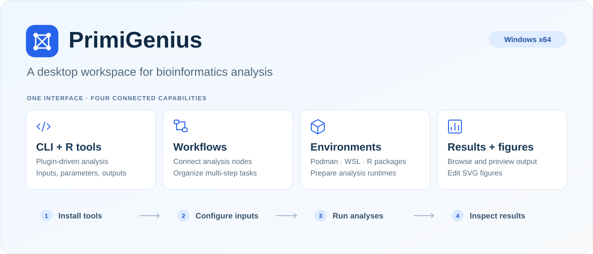
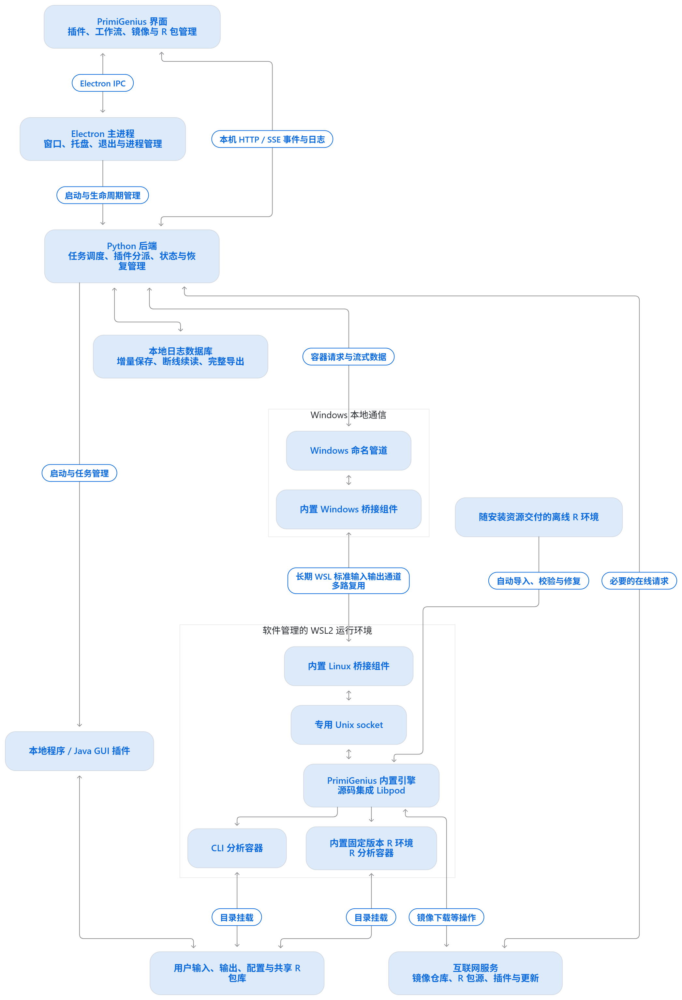

# PrimiGenius

**English** | [简体中文](README.zh-CN.md)

PrimiGenius is a Windows desktop application for bioinformatics. It brings command-line and R tools, workflow construction, container management, and result viewing into one interface. Available analyses depend on the plugins you install.

[Download](https://github.com/jianbai-design/PrimiGenius/releases) · [Report an issue](https://github.com/jianbai-design/PrimiGenius/issues) · [Plugin repository](https://github.com/jianbai-design/PrimiGenius-plugins)



## Features

| Feature | Description |
| --- | --- |
| CLI and R tools | Find installed tools and configure inputs, parameters, and output directories. |
| Workflow Builder | Connect tools into workflows and manage execution. |
| Plugin management | Browse the plugin store, use the community market, or install packages locally. |
| Runtime management | Manage the embedded WSL/container runtime and prepare the offline R environment. |
| Results and editing | Browse output files, preview supported formats, and edit SVG figures. |
| Desktop utilities | Chinese and English interfaces, execution logs, updates, and a built-in browser. |

## Install and use

Download `PrimiGenius-Setup-<version>.exe` from [Releases](https://github.com/jianbai-design/PrimiGenius/releases). The current installer targets **Windows x64**. Run it and follow the setup instructions; enabling WSL 2 and Podman may require administrator approval or a restart.

1. Start PrimiGenius and complete the runtime setup prompted by the application.
2. Install the plugins needed for your analyses.
3. Open a tool under **CLI Tools** or **R Tools**, or connect tools in **Workflow Builder**.
4. Select inputs and an output directory, run the analysis, and inspect logs and results.

Initial downloads of plugins, images, and R packages require network access. Offline availability depends on resources already installed. Analysis files remain in the selected local locations.

## Architecture in 1.2.0



The renderer uses Electron IPC for desktop integration and local HTTP/SSE for backend requests and logs. The Python backend manages tasks, persistent state, plugins and shared R libraries. Its container API runs through an owned Windows named pipe, the bundled Windows/Linux bridge, a multiplexed WSL standard-input/output channel and a dedicated Unix socket to the embedded Libpod engine. Native and Java GUI tools run as local processes.

The runtime is built from the pinned upstream source and the integration code under `runtime/engine` and `runtime/bridge`. The installer supplies the runtime and a fixed R 4.6.1 / Bioconductor 3.23 offline environment. Plugin, image, package and update downloads use their respective external services.

The GitHub-backed community market supports plugin submission, collaboration, review and signed installation. Its client and backend integration are included here; `marketplace/github` contains the workflow and processing sources used by the separate market repository. Private signing keys and account sessions are not part of the source.

## Run from source

Use Windows x64 with Node.js/npm and Python on `PATH`. This publication was prepared with Node.js 24.14.0 and Python 3.14.3; compatibility with other versions has not been established. Container tasks require WSL 2 and the matching bundled runtime resources described below. The application uses its embedded engine rather than a Windows Podman client.

```powershell
git clone https://github.com/jianbai-design/PrimiGenius.git
cd PrimiGenius
python -m venv .venv
.\.venv\Scripts\Activate.ps1
python -m pip install -r backend/requirements.txt pywin32==311
npm ci
npm start
```

The development launcher uses `python` from the active environment. The direct Python dependencies are pinned; transitive dependencies are not fully locked. The Docker SDK talks to the owned local bridge; a separate native Podman Python client is not required. No analysis plugins are included in this checkout.

## Build a Windows installer

The maintained entry point compiles the UI, validates runtime resources, freezes Python and builds a Windows x64 NSIS installer. Supply the following external build inputs first:

| Path | Resource |
| --- | --- |
| `runtime/release/` | Embedded engine, Windows/Linux bridge, rootfs, sources/licenses and checksum manifest, produced by `runtime/build.py` and `runtime/bundle.py`. |
| `runtime/r-environment/` | Matching offline R archive in `stage/`, license bundle and manifest metadata. Build/export tooling is in `build/build_r_environment.py`; the checked-in recipe and manifest describe the 1.2.0 resource contract. |
| `build/wsl.2.7.3.0.x64.msi` | Corresponding Windows x64 WSL installer. |
| `build/jre8.zip` | Redistributable Java 8 runtime archive, delivered as the complete `java/jre` tree. |

Runtime and R builds require an explicitly selected Linux/WSL build environment with the prerequisites declared in their recipes. Start with `python -B runtime/build.py --help` and `python -B build/build_r_environment.py --help`. Those recipes download or use external upstream inputs; this source checkout does not include built images or third-party runtime binaries. Resource licenses retain their own terms.

```powershell
npm ci
python -m pip install -r backend/requirements-build.txt
python -B build/build_installer.py --check
npm run dist
```

`build_installer.bat` invokes the same Python build entry point. Each build uses its own scratch directory and a new output directory under `dist_output/`; existing builds and user processes are preserved. `npm run dist:release` additionally requires matching recorded acceptance files; it never publishes a release. Building successfully does not establish full installation or upgrade compatibility.

`backend/init_podman.py` initializes or diagnoses the owned environment through the normal setup path and does not forcibly delete the existing machine.

## Source layout and checks

```text
main.js                 Electron process and desktop integration
src/                    UI, preview/editor modules and licensed browser assets
backend/                Python API, runtime, tasks, logs and dependencies
build/                  Installer/build scripts and application icon
runtime/engine/         Embedded Libpod integration, built inside pinned upstream
runtime/bridge/         Windows/Linux transport source and Go module checksums
runtime/                Runtime recipes, build tools and regression checks
runtime/r-environment/  Offline R recipe and manifest metadata, without images
marketplace/            Community market workflow, processing and checks
.docker/                Maintained R environment recipe
docs/                   README artwork and architecture diagrams
```

```powershell
node --check main.js
node --check src/renderer.js
python -B runtime/run_core_checks.py --output build/core-regression.json
node runtime/test_vector_runtime.cjs
node marketplace/test_market.cjs
```

Tests use disposable fixtures where appropriate. GUI, WSL and complete installer acceptance require their own runtime inputs and environment; the quick checks do not replace those checks. Runtime binaries, private keys, local session/state files, downloaded plugins, build caches and generated validation reports are excluded from the repository.

## License and scope

The main application is distributed under [GNU GPL v3.0](LICENSE). Third-party assets retain their own licenses; Font Awesome's terms are included in [its license file](src/vendor/fontawesome/LICENSE.txt).

Plugin source and packages, registries, container images, third-party runtime binaries, signing keys, and user data are outside this source publication. Plugins are maintained in the [separate plugin repository](https://github.com/jianbai-design/PrimiGenius-plugins) under their applicable terms. Old plugin packages were removed from the current repository tree; earlier commits remain in Git history.
