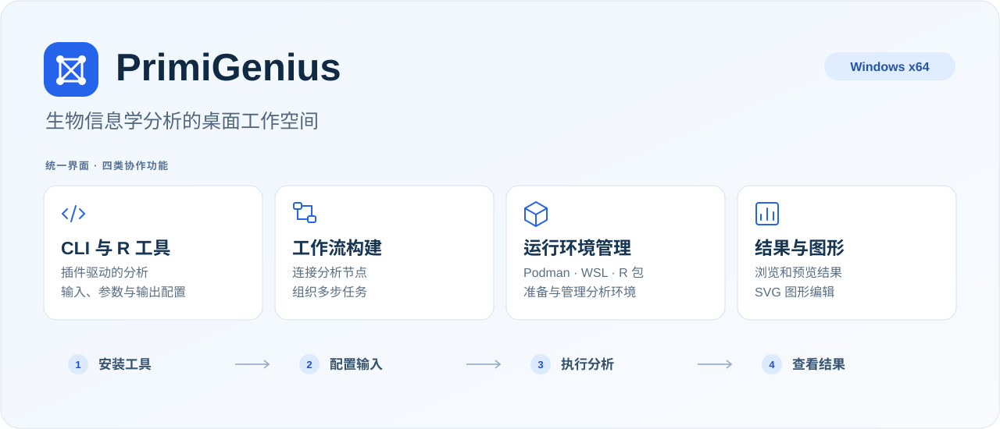
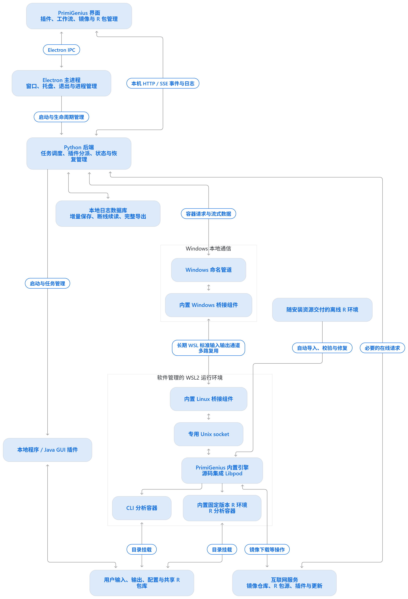

# PrimiGenius

[English](README.md) | **简体中文**

PrimiGenius 是面向生物信息学分析的 Windows 桌面程序，将命令行工具、R 工具、工作流构建、容器管理和结果查看集中在同一界面中。可用分析功能取决于用户安装的插件。

[下载安装包](https://github.com/jianbai-design/PrimiGenius/releases) · [反馈问题](https://github.com/jianbai-design/PrimiGenius/issues) · [插件仓库](https://github.com/jianbai-design/PrimiGenius-plugins)



## 功能

| 功能 | 说明 |
| --- | --- |
| CLI 与 R 工具 | 查找已安装工具，配置输入文件、参数和输出目录。 |
| Workflow Builder | 将工具连接成工作流并管理执行过程。 |
| 插件管理 | 浏览插件商店、使用自由市场或安装本地插件包。 |
| 运行环境管理 | 管理内置 WSL/容器运行环境并准备离线 R 环境。 |
| 结果查看与编辑 | 浏览输出文件，预览支持的格式，编辑 SVG 图形。 |
| 桌面辅助功能 | 中英文界面、执行日志、主程序更新和内置浏览器。 |

## 安装与使用

从 [Releases](https://github.com/jianbai-design/PrimiGenius/releases) 下载 `PrimiGenius-Setup-<版本>.exe`。当前安装包面向 **Windows x64**。运行并按提示安装；启用 WSL 2 和 Podman 时，可能需要管理员授权或重启。

1. 启动 PrimiGenius，按应用提示完成运行环境准备。
2. 安装分析所需的插件。
3. 在 **CLI Tools**、**R Tools** 中打开工具，或在 **Workflow Builder** 中连接工具。
4. 选择输入与输出目录，运行分析并查看日志和结果。

首次下载插件、镜像和 R 包需要联网；能否离线运行取决于本机已准备的资源。分析文件保存在所选的本地位置。

## 1.2.0 运行架构



界面通过 Electron IPC 调用桌面功能，通过本机 HTTP/SSE 与 Python 后端交换请求、状态和日志。后端管理任务、持久状态、插件与共享 R 包库；容器接口依次经过专用 Windows 命名管道、内置 Windows/Linux 桥接组件、复用的 WSL 标准输入输出通道和专用 Unix socket，连接内置 Libpod 引擎。原生程序与 Java GUI 插件通过本地进程运行。

运行引擎依据固定上游版本及 `runtime/engine`、`runtime/bridge` 中的集成源码构建。安装资源提供运行引擎和固定版本 R 4.6.1 / Bioconductor 3.23 离线环境；插件、镜像、软件包和主程序更新按需访问各自的分发服务。

自由市场基于 GitHub 实现插件提交、合作、审核及签名安装。本仓库包含市场客户端与后端适配；`marketplace/github` 提供部署到独立市场仓库的工作流与处理源码。签名私钥和账号会话不包含在源码中。

## 从源码运行

使用 Windows x64，并确保 Node.js/npm 和 Python 位于 `PATH` 中。本次发布整理环境为 Node.js 24.14.0 和 Python 3.14.3，其他版本的兼容性尚未确认。容器任务需要 WSL 2 及下述配套运行资源；应用通过内置引擎工作，不依赖 Windows Podman 客户端。

```powershell
git clone https://github.com/jianbai-design/PrimiGenius.git
cd PrimiGenius
python -m venv .venv
.\.venv\Scripts\Activate.ps1
python -m pip install -r backend/requirements.txt pywin32==311
npm ci
npm start
```

开发模式使用当前环境中的 `python`。依赖清单固定了直接 Python 依赖版本，尚未完整锁定传递依赖。Docker SDK 通过本地专用桥接通道连接引擎，不要求额外安装原生 Podman Python 客户端。本源码仓库不附带分析插件。

## 构建 Windows 安装包

当前构建入口依次编译界面、校验运行资源、冻结 Python 后端并生成 Windows x64 NSIS 安装包。打包前需要准备以下外部输入：

| 路径 | 资源 |
| --- | --- |
| `runtime/release/` | 内置引擎、Windows/Linux 桥接程序、rootfs、源码/许可证及摘要清单，由 `runtime/build.py` 和 `runtime/bundle.py` 生成。 |
| `runtime/r-environment/` | `stage/` 下的离线 R 压缩包、许可证包和清单元数据；构建/导出工具为 `build/build_r_environment.py`，已提交配方与清单说明 1.2.0 的资源约定。 |
| `build/wsl.2.7.3.0.x64.msi` | 对应 Windows x64 WSL 安装程序。 |
| `build/jre8.zip` | 可再分发的 Java 8 运行时压缩包，构建时交付为完整 `java/jre` 目录。 |

运行引擎和离线 R 的构建需要明确指定已备齐配方依赖的 Linux/WSL 构建环境。可先查看 `python -B runtime/build.py --help` 和 `python -B build/build_r_environment.py --help`。这些工具会下载或使用外部上游资源；本源码仓库不保存已构建镜像及第三方运行时二进制，相关资源保留各自许可条款。

```powershell
npm ci
python -m pip install -r backend/requirements-build.txt
python -B build/build_installer.py --check
npm run dist
```

`build_installer.bat` 调用相同 Python 构建入口。每次构建使用独立临时目录，并在 `dist_output/` 下新建输出目录，保留已有构建和用户进程。`npm run dist:release` 额外要求匹配的验收记录，不会自动发布版本。构建成功不等于完整安装或历史版本升级已通过验收。

`backend/init_podman.py` 通过正常初始化流程准备或诊断所属运行环境，不会强制删除已有机器。

## 源码目录与检查

```text
main.js                 Electron 主进程与桌面集成
src/                    界面、预览/编辑模块及附许可证的浏览器资源
backend/                Python API、运行环境、任务、日志和依赖清单
build/                  安装/构建脚本与应用图标
runtime/engine/         在固定上游源码树内构建的 Libpod 集成代码
runtime/bridge/         Windows/Linux 通信源码与 Go 模块摘要
runtime/                运行环境配方、构建工具与回归检查
runtime/r-environment/  离线 R 配方及清单元数据，不含镜像
marketplace/            自由市场工作流、处理逻辑与检查
.docker/                维护中的 R 环境配方
docs/                   README 配图与架构图
```

```powershell
node --check main.js
node --check src/renderer.js
python -B runtime/run_core_checks.py --output build/core-regression.json
node runtime/test_vector_runtime.cjs
node marketplace/test_market.cjs
```

测试按需使用隔离夹具。界面、WSL 及完整安装验收需要各自的运行资源和环境，快速检查不能替代这些验收。仓库排除运行时二进制、私钥、本地会话/状态、已下载插件、构建缓存和生成的验证报告。

## 许可证与公开范围

主程序依据 [GNU GPL v3.0](LICENSE) 分发。第三方资源保留各自许可证，Font Awesome 的许可文本位于[此文件](src/vendor/fontawesome/LICENSE.txt)。

插件源码及插件包、注册表、容器镜像、第三方运行时二进制、签名密钥和用户数据不属于本次源码公开范围。插件在[独立插件仓库](https://github.com/jianbai-design/PrimiGenius-plugins)维护，遵循各自适用的条款。旧插件包已从当前目录树中移除，早期提交仍保留在 Git 历史中。
